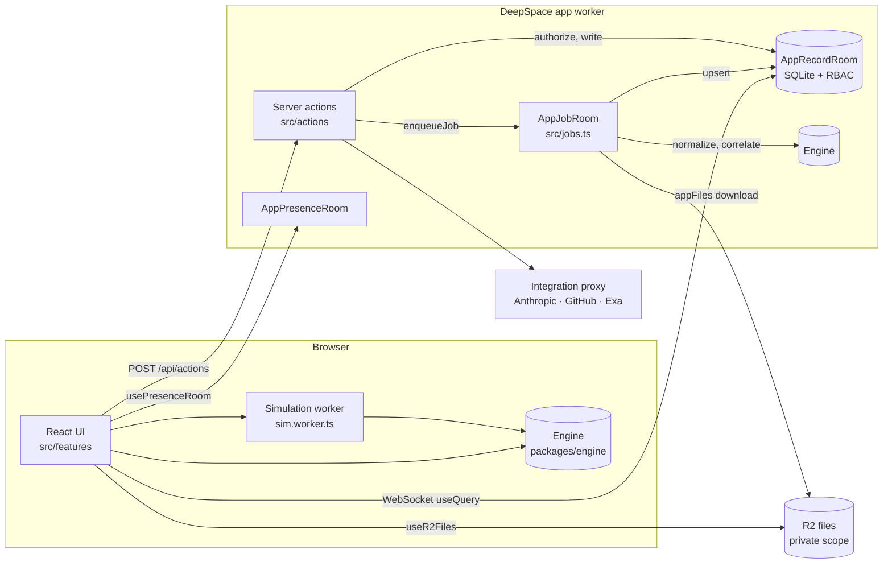

# Architecture

Faultline is one TypeScript codebase with two deployment targets:

- **DeepSpace (canonical, full stack)**: a Cloudflare Worker with Durable Objects for records, jobs, and presence, R2 file storage, DeepSpace authentication, and the integration proxy.
- **Vercel (standalone demo)**: the same UI and engines built as a static single-page app, with synthetic data and browser-local persistence.

## Layers

| Layer | Location | Responsibility |
| --- | --- | --- |
| Engine | `packages/engine` | Pure TypeScript, zero runtime dependencies, no DOM: normalization, correlation, hypothesis ranking, replay, discrete-event simulation, synthetic scenarios, postmortems, analytics. 88 unit tests. |
| Shared UI | `src/features` | Data-source-agnostic React components. The investigation workspace takes an `IncidentAnalysis` and a `WorkspaceAdapter`. |
| Adapters | `src/features/workspace/adapter.ts`, `src/features/cloud` | Browser-local adapter (demo, standalone) and DeepSpace records adapter (authenticated workspace). |
| Routes | `src/pages` (generouted) | Static public pages (landing, demo, docs) and `(app)` pages that mount DeepSpace providers. |
| Server | `worker.ts`, `src/server`, `src/actions`, `src/jobs.ts` | Hono worker, server actions (the only write path), the ingestion job, integrations. |
| Standalone entry | `src/vercel`, `vite.vercel.config.ts` | Explicit route table without DeepSpace providers. |

## Data flow: importing evidence

1. The browser does a **dry run** of normalization locally, so the user sees accepted, rejected, and duplicate counts before uploading.
2. The file uploads to the uploader's **private** R2 scope with `useR2Files()`.
3. `registerSource` checks that the file key lives in the caller's private area; `startIngestion` checks the collaborator role and calls `enqueueJob`.
4. `AppJobRoom` runs `runIngestion`: it re-checks the enqueuer's role, downloads with the uploader's own scope, normalizes, merges with existing events, correlates, ranks hypotheses, and upserts records. Every stage is written to an `ingestion_jobs` record.
5. Collaborators' `useQuery` subscriptions receive the new rows over WebSocket; the workspace re-renders.

## Data flow: the public demo

The demo page asks a Web Worker to run the scenario through the simulator (about 50,000 requests, roughly 2 s). The worker returns the synthetic dataset and the baseline run. The main thread runs `analyzeIncident` (correlation, ranking, replay index) in about 100 ms. Nothing touches the network, so the demo works with no account and on the static Vercel build.

## Why the engine runs in both places

The same `normalizeSource` and `analyzeIncident` run in the browser (dry runs, demos, simulation) and in the JobRoom (authoritative ingestion). Results are deterministic, so the preview a user sees matches what the server stores.

## Why the two deployments differ

DeepSpace authentication is same-origin by design: the browser trades its session cookie for a short-lived JWT at `/api/auth/token` on the app's own origin, and the auth worker trusts only `*.app.space`, `*.deep.space`, and `localhost` origins. A frontend on `vercel.app` therefore cannot sign in to the DeepSpace backend. Rather than ship a broken cross-origin integration, the Vercel build is a deliberately standalone demo that links to the canonical app.

## What changes at larger scale

- **Events per incident.** Records are tuned for thousands of small rows. Beyond the 5,000-event cap, move raw events to R2 or a D1/Hyperdrive table and keep only indexes, keyframes, and aggregates in records.
- **Correlation.** Candidate generation is already indexed and bounded. Very large incidents would correlate per time partition inside a job using `ctx.continue` checkpoints.
- **Simulation.** A 10-minute scenario at about 100 rps processes about 2 million scheduler events in about 2 s. Larger models would need sampling, fluid approximations, or batched runs inside background jobs.
- **Fan-out writes.** The records tools API writes one row per call; a bulk-write path would cut ingestion time considerably.
